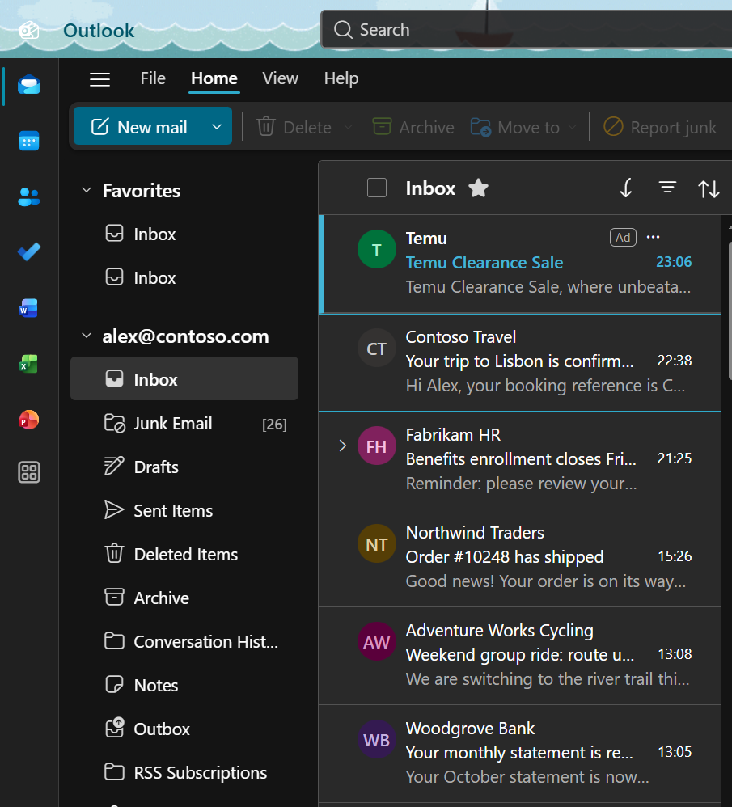
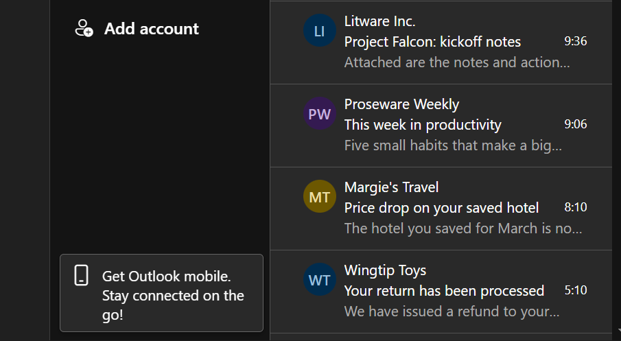
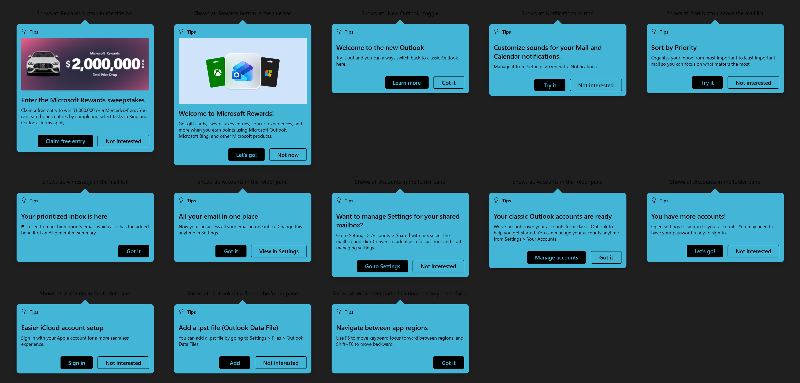
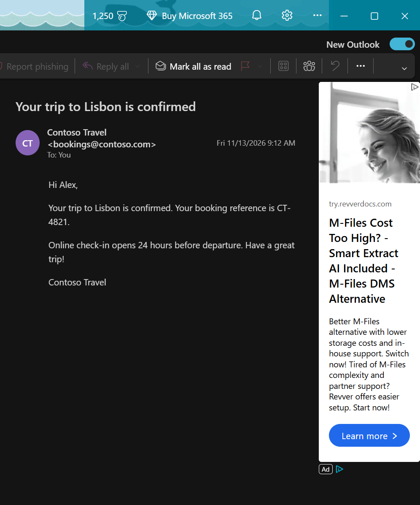
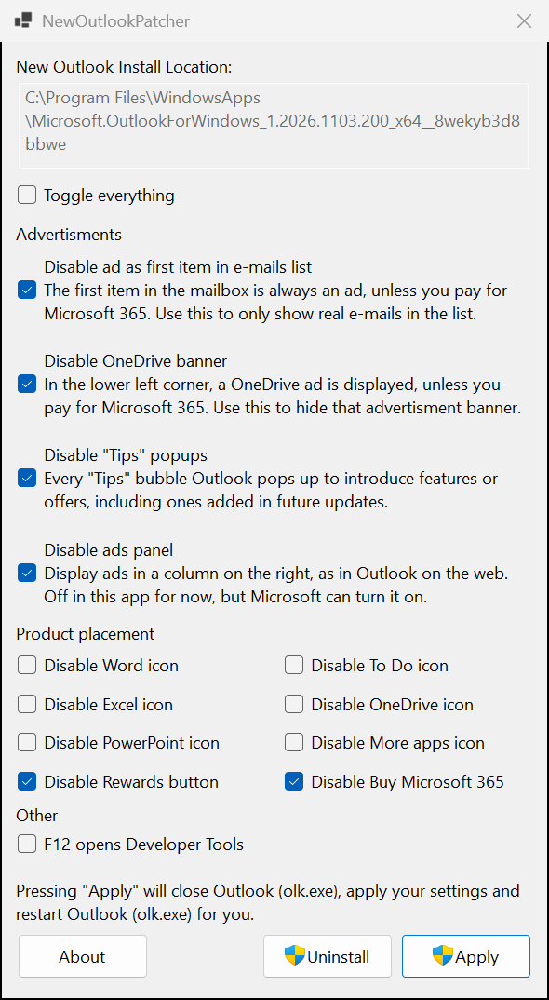

<h1>NewOutlookPatcher</h1>

Disable ads and product placement in new Outlook for Windows app.

Fork of <a href="https://github.com/valinet/NewOutlookPatcher">valinet/NewOutlookPatcher</a>, updated for the current new Outlook.

Tested on:

<ul>
  <li>Windows 10 Version 21H2 (OS Build 19044.4046)</li>
  <li>Windows 11 Version 23H2 (OS Build 22621.3296)</li>
  <li>Windows 11 Version 25H2 (OS Build 26200.9974) with new Outlook 1.2026.1026.100</li>
</ul>
<h2>Features</h2>

Each of these can be switched on or off in the patcher's window. The previews below show what each option removes; the mail and accounts in them are placeholders, the ads are real.

<h3>Advertisements</h3>
<h4>Disable ad as first item in e-mails list</h4>

Unless you pay for Microsoft 365, the first item in the mail list is an ad. It is hidden before Outlook draws it, together with the empty space Outlook reserves for it while it loads.

<h4>Disable OneDrive banner</h4>

A banner at the bottom of the folder pane, promoting OneDrive storage, Microsoft 365 or the Outlook mobile app.

<h4>Disable "Tips" popups</h4>

Every "Tips" bubble Outlook pops up to introduce features or offers, such as the Microsoft Rewards sweepstakes, including ones added in future updates. These are the ones in the current Outlook, each with where it normally appears:

<h4>Disable ads panel</h4>

A column of display ads on the right, as in Outlook on the web. Microsoft currently keeps it switched off in the app, but can turn it on at any time.

<h3>Product placement</h3>
<ul>
  <li>Disable Word, Excel, PowerPoint, To Do, OneDrive and More apps icons in the sidebar</li>
  <li>Disable Rewards and Buy Microsoft 365 buttons in the title bar</li>
</ul>
<h3>Other</h3>
<ul>
  <li>F12 opens Developer Tools</li>
</ul>

  

<h2>How to?</h2>
<ol type="1">
  <li>Download <code>NewOutlookPatcher.exe</code> from the <a href="https://github.com/dyang886/NewOutlookPatcher/releases/latest">latest release</a>.</li>
  <li>Run <code>NewOutlookPatcher</code>. Outlook will also open automatically in the background.</li>
  <li>Customize the configuration by checking/unchecking individual items.</li>
  <li>Press <code>Install</code>. The application will elevate itself, close Outlook, apply your setttings and restart Outlook for you.</li>
</ol>
<h2>Why is elevation required?</h2>
The patcher requires administrative access in order to perform the following operations:
<ul>
  <li>Installing the patcher (<code>NewOutlookPatcher.dll</code>) in <code>C:\Windows\System32\</code> which is write-protected for regular users.</li>
  <li>Configuring New Outlook for Windows to load the patcher when it starts up using the registry (in <code>HKLM\SOFTWARE\Microsoft\Windows NT\CurrentVersion\Image File Execution Options\olk.exe</code>).</li>
</ul>
<h2>Uninstalling</h2>

Run <code>NewOutlookPatcher</code> and press the <code>Uninstall</code> button. Done.

<h2>Known issues</h2>
<ul>
  <li>Patcher does not start? Install <a href="https://dotnet.microsoft.com/en-us/download/dotnet/thank-you/runtime-desktop-8.0.3-windows-x64-installer">.NET Desktop Runtime 8</a>.</li>
  <li>Patcher is x64-only at the moment.</li>
</ul>
<h2>How it works?</h2>
<ul>
  <li>Everything is packed together in a tiny .NET 8-based executable. Required resources are extracted to a temporary folder at runtime.</li>
  <li>New Outlook (<code>olk.exe</code>) is patched using a DLL that is injected in its process. The DLL is loaded using the <code>AppVerifier</code> infrastructure. The project contains a very clean C++ implementation of this technique. This works because the process is not protected, thus being able to load unsigned code.</li>
  <li>The actual patching is done by hooking WebView2 methods, so that a script runs in Outlook's page before any of Outlook's own code. It hides elements with CSS and by the name of the React component that draws them, which, unlike Outlook's generated class names, survives Outlook updates.</li>
</ul>
<h2>Solution structure</h2>

The Visual Studio solution is divided in 5 projects:

<ul>
  <li>gui: Contains user interface and unpacker logic, C# .NET 8.</li>
  <li>worker: Module that gets loaded by Outlook which injects custom JavaScript and CSS in the user interface.</li>
</ul>

Successful compilation is only possible for x64 at the moment. Files packed in the final executable are always grabbed from the <code>Release</code> folder, beware when building in <code>Debug</code>.

To build <code>NewOutlookPatcher.exe</code>, run the <code>Build NewOutlookPatcher.exe</code> task in VS Code (<kbd>Ctrl</kbd>+<kbd>Shift</kbd>+<kbd>B</kbd>), or <code>powershell -ExecutionPolicy Bypass -File build.ps1</code>. It needs Visual Studio 2022 with the "Desktop development with C++" workload and the .NET 8 SDK (or newer). The result is <code>x64\Release\publish\NewOutlookPatcher.exe</code>.

